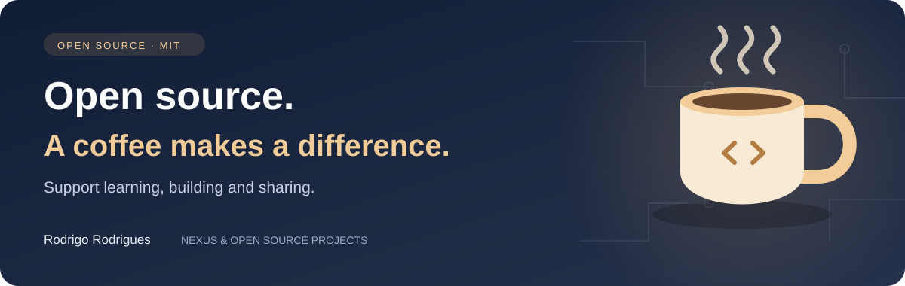

<p align="right">
  <a href="README.md"></a>
  <a href="README.en-US.md"></a>
  <a href="README.es-AR.md"></a>
</p>

# headers-seguros

<!-- public-badges:start -->
[](LICENSE) [](https://github.com/Rdraim/headers-seguros/actions) [](https://github.com/Rdraim/headers-seguros/releases) [](https://github.com/Rdraim/headers-seguros/commits/main)
<!-- public-badges:end -->

Configurable HTTP security headers for Node.js and Express/Connect, without runtime dependencies.

## Start here

Requires Git and Node.js 22+ for tests. No runtime dependencies. Download the actual repository rather than an unverified same-name npm package.

```sh
git clone https://github.com/Rdraim/headers-seguros.git
cd headers-seguros
npm test
node tools/check-public-content.mjs
```

These imports work from the cloned repository root. To use the module in another project, install a pinned Git tag (v1.3.0) or copy the module while retaining the MIT license. This documentation does not claim an npm registry release.

```js
import { construirHeaders, headersSeguros } from './src/index.js';
const headers = construirHeaders({ hsts: false }); // local HTTP
// app.use(headersSeguros({ hsts: true, includeSubDomains: false }));
```

## API

`construirHeaders(opcoes)`; `headersSeguros(opcoes)`; `CSP_PADRAO`.

Public function and option names remain in Portuguese for compatibility.

## Behavior and limits

Options: `csp` (true, false, or a directive map containing source arrays; null/false removes a directive), `hsts`, `hstsMaxAge`, `includeSubDomains`, `hstsIncondicional`, `frame`, `referrer`, `permissions`. HSTS defaults to 15552000 seconds and includes subdomains; since 1.3.0 the middleware sends it only on secure requests and never to loopback hosts (see [HSTS](#hsts)). Confirm subdomain readiness before enabling that scope.

| option | default | description |
|---|---|---|
| `csp` | `true` | `false` disables it; an object extends/overrides directives |
| `cspReportOnly` | `false` | `true` sends the CSP as `Content-Security-Policy-Report-Only` |
| `hsts` | `true` | `Strict-Transport-Security`; `false` disables it |
| `hstsMaxAge` | `15552000` | HSTS lifetime (seconds) |
| `includeSubDomains` | `true` | adds `includeSubDomains` to HSTS |
| `hstsIncondicional` | `false` | middleware only: `true` sends HSTS on every response, including HTTP and loopback (behavior up to 1.2.x) |
| `frame` | `'DENY'` | `X-Frame-Options` (`DENY` or `SAMEORIGIN`) |
| `referrer` | `'no-referrer'` | `Referrer-Policy` |
| `permissions` | `camera=(), microphone=(), geolocation=()` | `Permissions-Policy` |

`construirHeaders` does not see the request: with `hsts: true` the returned object always contains `Strict-Transport-Security`. Without the middleware, send that header only over HTTPS and outside loopback, or use `hsts: false` on HTTP. `frame: SAMEORIGIN` also requires an appropriate CSP `frame-ancestors` value. COOP/CORP can affect external integrations. These headers do not replace authorization, CSRF defenses or a security review.

## HSTS

Since 1.3.0 the `headersSeguros` middleware sends `Strict-Transport-Security`
only when the request is secure (`req.secure === true` or a TLS socket) and
never to loopback hosts: `localhost`, `*.localhost`, `127.0.0.0/8` and `::1`,
with or without a port. Browsers ignore HSTS received over plain HTTP, and on
loopback the header would lock your development environment into HTTPS.

The `X-Forwarded-Proto` header is not read. Behind a TLS-terminating proxy, use
Express `trust proxy` (which sets `req.secure`) or send HSTS from the proxy
itself. `hstsIncondicional: true` restores sending it on every response.

If an earlier version left `localhost` forced to HTTPS, clear it by serving one
HTTPS response with `{ hstsIncondicional: true, hstsMaxAge: 0 }` or by deleting
the host's HSTS entry in the browser settings.

HSTS applies to the host on **every port**. If the same name is also served
over plain HTTP on another port, after one HTTPS visit the browser forces HTTPS
on that port too, and that access breaks until `max-age` expires. Start with a
short `max-age` and enable `includeSubDomains` only after checking that every
subdomain answers over HTTPS:

```js
app.use(headersSeguros({ hstsMaxAge: 300, includeSubDomains: false })); // first rollout
// once validated: raise hstsMaxAge and, if appropriate, includeSubDomains: true
```

## Permissions-Policy

The default stays `camera=(), microphone=(), geolocation=()`. To also block the
serial port, USB and HID APIs, pass the full policy in `permissions` (the value
replaces the default):

```js
app.use(headersSeguros({
  permissions: 'camera=(), microphone=(), geolocation=(), serial=(), usb=(), hid=()',
}));
```

## Maintenance

These standalone modules are inspired by work on Nexus, Rodrigo Rodrigues's independent project. They contain no private database, deployment configuration, logs, credentials or user records. Coordinated maintenance means reviewing related changes in the same release cycle, not automatically copying private source files.

## Security and compatibility

Immutable CSP defaults, malformed configuration rejection and HSTS subdomain control.

[Contributing](CONTRIBUTING.en-US.md) · [Security](SECURITY.en-US.md)

MIT © Rodrigo Rodrigues

Official reference: https://developer.mozilla.org/en-US/docs/Web/HTTP/Headers/Content-Security-Policy


## Practical use — 1.2.0

`cspReportOnly: true` lets you assess a policy before enforcing it. This mode does not block content; collecting reports requires your own configured endpoint. Boolean options reject ambiguous strings.

Runnable example with synthetic data: `node examples/uso.mjs`.

---

<p align="center">
  
</p>

## ☕ Buy me a coffee

Did this project help you solve a problem, learn something new, or take your first steps in development? If you feel like supporting my work, a coffee is a kind way to say thank you.

I’m **Rodrigo Rodrigues**, creator of **Nexus** and these open source projects. Your support helps me set aside time to improve the code, write clearer examples, and keep sharing what I learn.

**Give any amount that feels right to you. Supporting is completely optional — the project remains free under the MIT license.**

<p>
  <a href="#support-via-pix"></a>
  <a href="https://github.com/Rdraim/headers-seguros/issues/new?title=Feedback%3A%20this%20project%20helped%20me"></a>
</p>

### Support via Pix

In your banking app, scan the QR code or copy the Pix key below. Choose your amount and check the recipient details before confirming.

<p align="center">
  
</p>

**Pix key**

```text
8875a24e-44d1-4c91-b6bb-62c9f0070955
```

Pix is Brazil’s payment system. If your bank does not support it, you can still help by sharing the project, reporting a bug, improving the documentation, or leaving feedback.

### Your feedback matters, too

[Tell me how the project helped you](https://github.com/Rdraim/headers-seguros/issues/new?title=Feedback%3A%20this%20project%20helped%20me). I’d love to hear what you built, what you learned, and what could be clearer for someone just starting out.

A comment is welcome with or without a donation. Please keep payment receipts, personal details, credentials and private user data out of public Issues.

---

**Thank you for supporting my work and helping me keep building and sharing. ❤️**
