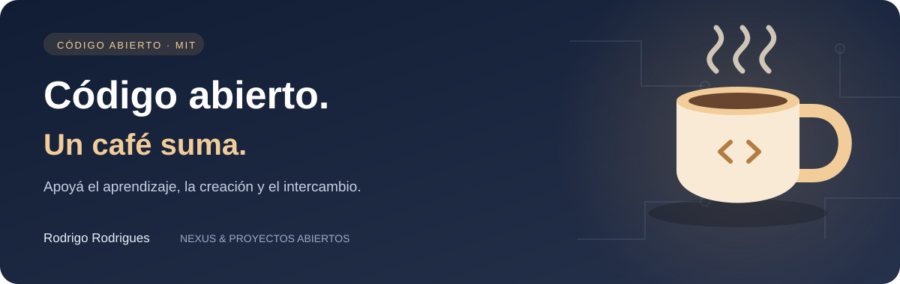

<p align="right">
  <a href="README.md"></a>
  <a href="README.en-US.md"></a>
  <a href="README.es-AR.md"></a>
</p>

# headers-seguros

<!-- public-badges:start -->
[](LICENSE) [](https://github.com/Rdraim/headers-seguros/actions) [](https://github.com/Rdraim/headers-seguros/releases) [](https://github.com/Rdraim/headers-seguros/commits/main)
<!-- public-badges:end -->

Cabeceras de seguridad HTTP configurables para Node.js y Express/Connect, sin dependencias de ejecución.

## Empezá acá

Necesitás Git y Node.js 22+ para las pruebas. Sin dependencias de ejecución. Descargá este repositorio; no instales un paquete homónimo sin verificar del registro npm.

```sh
git clone https://github.com/Rdraim/headers-seguros.git
cd headers-seguros
npm test
node tools/check-public-content.mjs
```

Las importaciones del ejemplo funcionan desde la raíz del repositorio clonado. Para usar el módulo en otro proyecto, fijá una revisión Git (tag v1.2.1) o copiá el módulo conservando la licencia MIT. Esta documentación no afirma que exista una publicación en el registro npm.

```js
import { construirHeaders, headersSeguros } from './src/index.js';
const headers = construirHeaders({ hsts: false }); // HTTP local
// app.use(headersSeguros({ hsts: true, includeSubDomains: false }));
```

## API

`construirHeaders(opcoes)`; `headersSeguros(opcoes)`; `CSP_PADRAO`.

Los nombres públicos de funciones y opciones se mantienen en portugués por compatibilidad.

## Comportamiento y límites

Opciones: `csp` (true, false o mapa de directivas con arrays de fuentes; null/false elimina una directiva), `hsts`, `hstsMaxAge`, `includeSubDomains`, `hstsIncondicional`, `frame`, `referrer`, `permissions`. HSTS dura 15552000 segundos e incluye subdominios por defecto; desde la 1.3.0 el middleware solo lo envía en solicitudes seguras y nunca a hosts de loopback (ver [HSTS](#hsts)). Verificá que todos los subdominios estén preparados antes de habilitar ese alcance. `frame: SAMEORIGIN` también requiere una directiva CSP `frame-ancestors` adecuada. COOP/CORP pueden afectar integraciones externas. Estas cabeceras no reemplazan autorización, defensas CSRF ni una revisión de seguridad.

| opción | predeterminado | descripción |
|---|---|---|
| `csp` | `true` | `false` la desactiva; un objeto extiende/reemplaza directivas |
| `cspReportOnly` | `false` | `true` envía la CSP como `Content-Security-Policy-Report-Only` |
| `hsts` | `true` | `Strict-Transport-Security`; `false` lo desactiva |
| `hstsMaxAge` | `15552000` | vigencia del HSTS (segundos) |
| `includeSubDomains` | `true` | agrega `includeSubDomains` al HSTS |
| `hstsIncondicional` | `false` | solo en el middleware: `true` envía el HSTS en toda respuesta, incluso HTTP y loopback (comportamiento hasta la 1.2.x) |
| `frame` | `'DENY'` | `X-Frame-Options` (`DENY` o `SAMEORIGIN`) |
| `referrer` | `'no-referrer'` | `Referrer-Policy` |
| `permissions` | `camera=(), microphone=(), geolocation=()` | `Permissions-Policy` |

`construirHeaders` no conoce la solicitud: con `hsts: true` el objeto siempre trae `Strict-Transport-Security`. Sin el middleware, enviá esa cabecera solo por HTTPS y fuera de loopback, o usá `hsts: false` en HTTP.

## HSTS

Desde la 1.3.0 el middleware `headersSeguros` solo envía
`Strict-Transport-Security` cuando la solicitud es segura (`req.secure === true`
o socket TLS) y nunca a hosts de loopback: `localhost`, `*.localhost`,
`127.0.0.0/8` y `::1`, con o sin puerto. El navegador ignora el HSTS recibido
por HTTP plano, y en loopback la cabecera dejaría el entorno de desarrollo
atrapado en HTTPS.

La cabecera `X-Forwarded-Proto` no se lee. Detrás de un proxy que termina el TLS,
usá el `trust proxy` de Express (que completa `req.secure`) o enviá el HSTS desde
el propio proxy. `hstsIncondicional: true` restaura el envío en toda respuesta.

El HSTS vale para el host en **todos los puertos**. Si el mismo nombre también se
sirve por HTTP plano en otro puerto, después de una visita por HTTPS el navegador
fuerza HTTPS también en ese puerto, y ese acceso queda roto hasta que vence el
`max-age`. Empezá con un `max-age` corto y activá `includeSubDomains` recién
después de comprobar que todos los subdominios responden por HTTPS:

```js
app.use(headersSeguros({ hstsMaxAge: 300, includeSubDomains: false })); // primera prueba
// una vez validado: subí el hstsMaxAge y, si corresponde, includeSubDomains: true
```

## Permissions-Policy

El valor predeterminado sigue siendo `camera=(), microphone=(), geolocation=()`.
Para bloquear también las API de puerto serie, USB y HID, pasá la política
completa en `permissions` (el valor reemplaza al predeterminado):

```js
app.use(headersSeguros({
  permissions: 'camera=(), microphone=(), geolocation=(), serial=(), usb=(), hid=()',
}));
```

## Seguridad y compatibilidad

CSP predeterminada inmutable, rechazo de configuraciones mal formadas y control de subdominios HSTS.

## Uso práctico — 1.2.0

`cspReportOnly: true` permite evaluar una política antes de aplicarla. Este modo no bloquea contenido; recopilar informes requiere un endpoint propio configurado. Las opciones booleanas rechazan cadenas ambiguas.

Ejemplo ejecutable con datos sintéticos: `node examples/uso.mjs`.

## Mantenimiento

Estos módulos independientes se inspiran en problemas resueltos en Nexus, proyecto de Rodrigo Rodrigues. No incluyen bases privadas, configuración de despliegue, logs, credenciales ni registros de usuarios. El mantenimiento coordinado consiste en revisar cambios relacionados en el mismo ciclo; no copia automáticamente archivos privados.

[Cómo contribuir](CONTRIBUTING.es-AR.md) · [Seguridad](SECURITY.es-AR.md)

MIT © Rodrigo Rodrigues

Referencia oficial: https://developer.mozilla.org/en-US/docs/Web/HTTP/Headers/Content-Security-Policy

---

<p align="center">
  
</p>

## ☕ Invitame un café

¿Este proyecto te ayudó a resolver un problema, aprender algo nuevo o dar tus primeros pasos en desarrollo? Si querés apoyar mi trabajo, un café es una linda forma de agradecer.

Soy **Rodrigo Rodrigues**, creador de **Nexus** y de estos proyectos de código abierto. Tu aporte me ayuda a dedicar tiempo a mejorar el código, escribir ejemplos más claros y seguir compartiendo lo que aprendo.

**Aportá el monto que tenga sentido para vos. El apoyo es totalmente voluntario; el proyecto sigue siendo gratuito bajo la licencia MIT.**

[Apoyá con Pix](#apoyá-con-pix) · [Dejá un comentario](https://github.com/Rdraim/headers-seguros/issues/new?title=Comentario%3A%20este%20proyecto%20me%20ayud%C3%B3)

### Apoyá con Pix

En la app de tu banco, escaneá el QR o copiá la clave Pix de abajo. Elegí el monto y revisá los datos del destinatario antes de confirmar.

<p align="center">
  
</p>

**Clave Pix**

```text
8875a24e-44d1-4c91-b6bb-62c9f0070955
```

Pix es el sistema de pagos de Brasil. Si tu banco no lo admite, también podés ayudar compartiendo el proyecto, reportando un problema, mejorando la documentación o dejando un comentario.

### Tu comentario también suma

[Contame cómo te ayudó el proyecto](https://github.com/Rdraim/headers-seguros/issues/new?title=Comentario%3A%20este%20proyecto%20me%20ayud%C3%B3). Me gustaría saber qué creaste, qué aprendiste y qué podría ser más claro para quienes recién empiezan.

Los comentarios son bienvenidos con o sin donación. Cuidá tu privacidad: no publiques comprobantes de pago, datos personales, credenciales ni información privada de usuarios en las Issues.

**Gracias por apoyar mi trabajo y ayudarme a seguir creando y compartiendo. ❤️**
